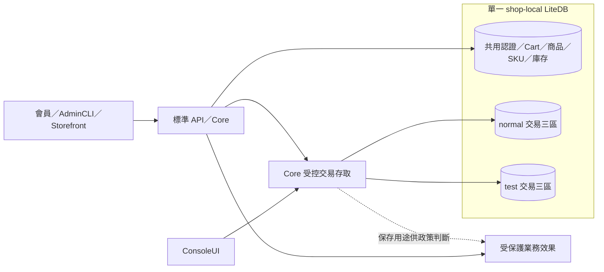
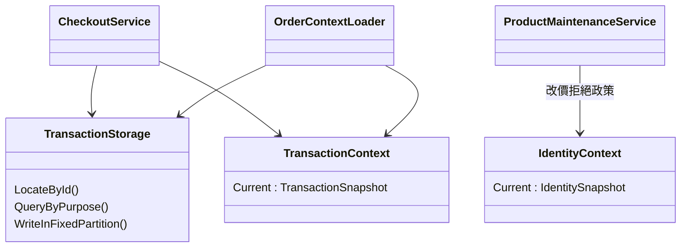
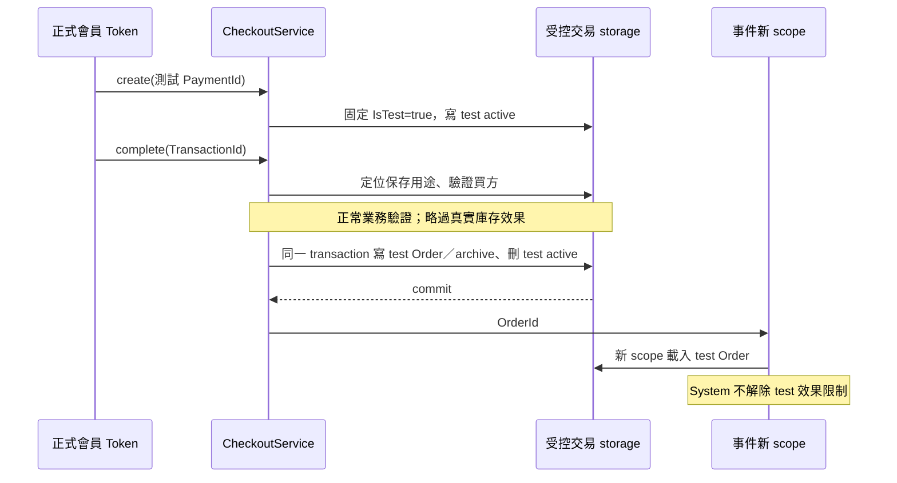

# TiP Phase 3 規格與重構範圍 review

日期：2026-10-19。本文保留規格凍結時的 review 快照；後續使用者已授權實作，目前結果見 [Phase 3.6 交付](phase3.6-delivery.md)。**下列狀態描述的是當時僅同步需求規格與案例、尚未開始程式重構的階段；現有部署 DB 仍未遷移。** 業務原則依使用者決定，以下具體配置與實作切分已由使用者回覆「OK」確認，並授權提交 docs／spec。

主要入口：[重構計畫](../../spec/tip-phase3-plan.md)、[交易儲存規格](../../spec/tip-transaction-storage.md)、[26 個隔離案例](../../spec/testcases/tip-transaction-storage.md)、[Phase 3 決策](../decisions/2026-10-19-tip-phase3-spec-and-refactor-plan.md)。

## 已同步的要求

| 使用者決定 | 規格與驗收位置 | 實作狀態 |
|---|---|---|
| 嚴格邊界在交易，建立後不變 | 交易儲存／標準流程／生命週期；STORE-001～007、009～014 | Phase 2 已固定用途；storage 分區待 Phase 3。 |
| 認證、Cart、商品、SKU、庫存共用 | 交易儲存／Context；STORE-002、017、018 | 維持現有認證來源；需調整 history 合併存取。 |
| 統一 API，不能按 Token 分區 | 交易儲存／HTTP；STORE-002、008、017 | locator、兩用途唯一 ID 與所有存取接入待實作。 |
| test identity 明確拒絕商品改價 | AC-TIP-005／HTTP；FLOW-303、HTTP-004、STORE-019／020 | 舊成功略過語意已從現行需求移除；程式待修改。 |
| test identity 可交易，但 test transaction 無實際業務效果 | 標準流程／Context；STORE-009～014、018 | 既有效果控制保留並補分區驗收；不存在的 adapter 不宣稱完成。 |
| PoC 拆 collection 即可 | 交易儲存／shop-runtime isolation；STORE-001～026 | 同一 LiteDB 檔案，三種交易資料各分 normal／test。 |

SKU 維護保持既有驗證後略過規則，沒有擴張為新的禁止操作。test 交易仍執行庫存／商品等正常檢查，可以失敗；交易與 log 保存不算實際業務效果。

## 已確認的具體配置

1. **Collection 命名**：normal 保留原三個名稱，test 使用 `test_orders`、`test_checkout_transactions`、`test_archived_checkout_transactions`。公開 `purpose=normal/test/all` 不改。
2. **改價拒絕**：HTTP 403、`test_identity_forbidden`、Outcome=Rejected，沒有 `product.update` skipped effect。只更新現有 Core 維護入口與測試探針，不新增維護 API。
3. **既有資料**：使用離線明確遷移、保留 raw BSON／ID／歷史缺值；停寫、備份、一次提交與失敗 rollback，新版拒絕未遷移 DB。現有會刪資料的 seed 路徑不能直接用於遷移。
4. **執行切分**：依 3.1～3.6 順序完成儲存、交易事件、身分限制、查詢、遷移及整體驗收；Abstract 不需變更。

## 架構與資料流

以下為 Phase 3 目標，不是目前部署圖。C4 容器層維持單一 shop host 與一份 LiteDB；內部分區只是 collection，不是獨立 DB 權限或程序隔離。



Core 內部 storage 元件名稱留實作選定；下圖只表達責任，不新增 Abstract 公開介面。





## 從現有程式確認的變更範圍

- [ShopDatabaseContext](../../src/AndrewDemo.NetConf2023.Core/ShopDatabaseContext.cs) 目前註冊三個 mixed transaction collections；只增加 test 屬性不夠，還需集中名稱、guard、index、ID 及可寫入口。
- [CheckoutService](../../src/AndrewDemo.NetConf2023.Core/Checkouts/CheckoutService.cs)、[Checkout loader](../../src/AndrewDemo.NetConf2023.Core/Contexts/ExecutionServices.cs)、[Order loader](../../src/AndrewDemo.NetConf2023.Core/Orders/OrderContextLoader.cs) 有直接 collection 存取；complete、封存、fulfillment 更新與事件都要接同一交易定位規則。
- [AdminQueryService](../../src/AndrewDemo.NetConf2023.Core/AdminQueries/AdminQueryService.cs) 目前合併 active／archive，需擴為依 purpose 選區；[MemberController](../../src/AndrewDemo.NetConf2023.API/Controllers/MemberController.cs) 與 [ConsoleUI](../../src/AndrewDemo.NetConf2023.ConsoleUI/Program_HelperFunctions.cs) 直接讀 Orders，需保留會員自身兩用途 history。
- [ProductMaintenanceService](../../src/AndrewDemo.NetConf2023.Core/Products/ProductMaintenanceService.cs) 的改價需從成功略過改為拒絕，避免把相同變更套到 SKU 或交易效果。
- [DatabaseInit](../../src/AndrewDemo.NetConf2023.DatabaseInit/Program.cs) 現行初始化會刪除輸出 DB；Phase 3 必須提供獨立、安全的遷移路徑，更新 seed／fixture 與啟動 readiness，不能直接重跑 seed。

主要風險是漏接 raw 存取、各區獨立配 ID、只讀單一分區而漏掉會員 test history、事件重建錯用途，以及多 collection 查詢看到不同提交狀態。這些已列為明確 testcase，不以人工記得加 filter 作為唯一保證。

## 規格同步與驗證狀態

- 已修訂正式 spec、testcases、AC-TIP-005、設計說明、coverage、Phase 1／2 索引、decisions 及 roadmap。舊 Phase 2 交付紀錄保留當時版本，不將舊測試改報為新需求通過。
- Abstract 現有 IIdentityContext／ITransactionContext、OrderId、OperationOutcome.Rejected 可沿用；本次沒有 contract 或程式變更。
- 既有基準：solution build 成功，0 errors、5 個既有 warnings；solution 測試 **448 passed、0 failed、0 skipped**。ConsoleUI 另行 build 成功，0 errors／warnings。
- 文件檢查：新增連結目標均存在、Markdown 表格欄數一致、26 個 STORE ID 唯一、git diff --check 通過；src／tests／Abstract 無 tracked diff。
- Phase 3 的 26 案、改價拒絕、實際分區與遷移均尚未實作／執行。沒有部署或更動任何使用中的資料庫。

本次實際執行命令（build 與 test 串行）：

```sh
dotnet build src/AndrewDemo.NetConf2023.slnx --no-restore --nologo -m:1
dotnet test src/AndrewDemo.NetConf2023.slnx --no-restore --no-build --nologo -m:1
dotnet build src/AndrewDemo.NetConf2023.ConsoleUI/AndrewDemo.NetConf2023.ConsoleUI.csproj --no-restore --nologo -m:1
git diff --check
```

測試分布：AdminCLI 106、Core 161、WebContract 141、AppleBTS Extension 19、PetShop Extension 13、PetShop API 8。上述只證明重構前程式基準，未執行新的 STORE 案例。
