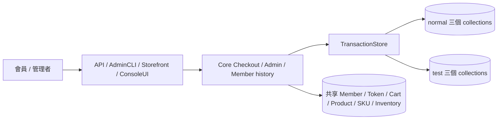
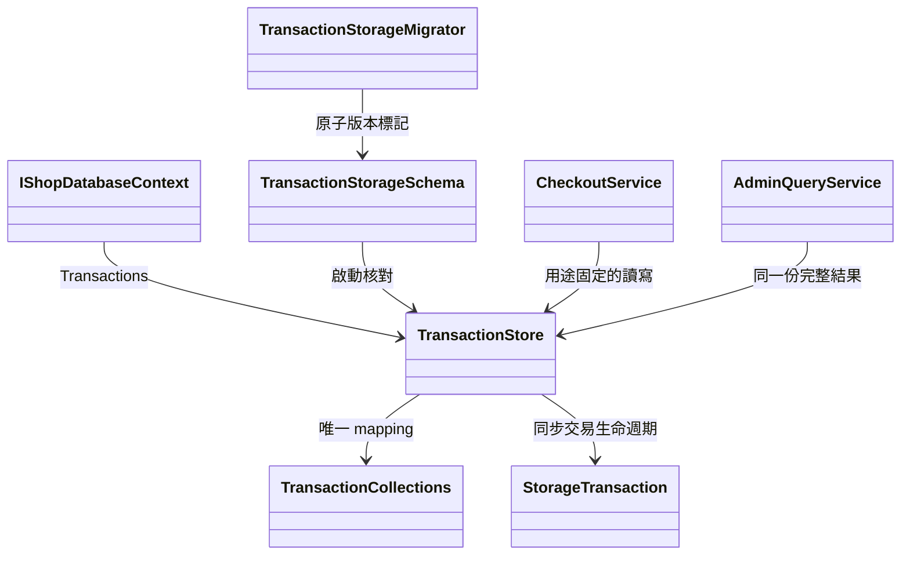

# Phase 3.1：儲存邊界與識別

2026-10-19。已實作及驗證，待使用者 review。遵循 [frozen storage 規格](../../spec/tip-transaction-storage.md)，Abstract／spec 未異動。

## 邊界與實作

`ShopDatabaseContext.Transactions` 提供 concrete `TransactionStore`；移除舊 Orders／CheckoutTransactions／ArchivedCheckoutTransactions 可寫 collection 屬性及舊 guards。一般應用不接受 collection 名稱，也不由 Token 路由。

| 物件 | normal | test |
|---|---|---|
| Order | orders | test_orders |
| active Checkout | checkout_transactions | test_checkout_transactions |
| archived Checkout | archived_checkout_transactions | test_archived_checkout_transactions |

locator 掃描同類全部分區，確認 ID 唯一、raw IsTest 與位置一致，並驗證存在的 Order／Checkout 關聯用途。只有 normal 完全缺 IsTest 可視為 false；null／錯型別、test 缺欄位、重複 ID 一律拒絕。Checkout ID 跨四區配發，Order ID 跨兩區配發，共同名稱鎖保護讀寫。store 不提供通用 Update／Upsert／Delete 或修改封存的入口。

新空 DB 建立六區索引及 `transaction_storage` 版本 1；有資料的未遷移 DB／未知版本拒絕初始化。raw Database 保留給共用資訊與 infrastructure，不能視為能防禦任意惡意程式碼的安全沙盒；本輪所有正式交易讀寫已經集中。

## 驗證

[TransactionStorageTests](../../tests/AndrewDemo.NetConf2023.Core.Tests/TransactionStorageTests.cs) 覆蓋 STORE-004～007、014：錯區、缺值、重複、關聯矛盾與禁止覆寫；四區預置最大 ID 後 20 個並行新增取得 41～60。CheckoutLifecycleTests 驗證兩區既有 Order #70／#90 不被覆寫，新訂單為 #91。StorageProcessTests 驗證封存後關閉重開，下一 Checkout ID 不重用。

STORE-025 的初始化閘門由 TransactionMigrationTests、實際全新 seed／API smoke 驗證。完整命令與結果集中於 [3.6](phase3.6-delivery.md)。
