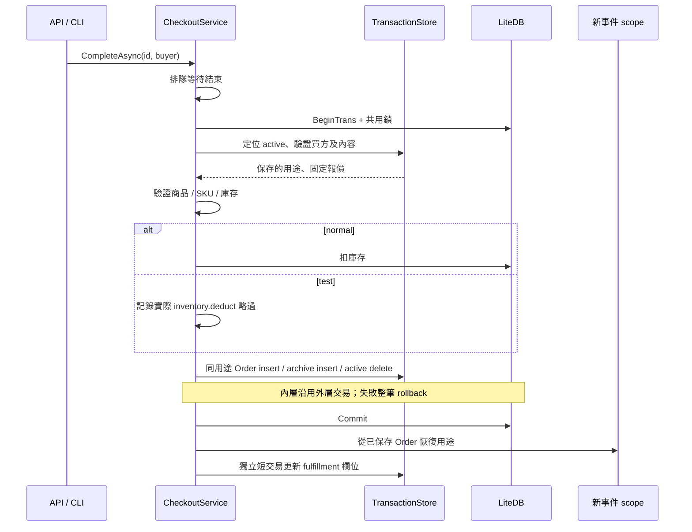

# Phase 3.2：Checkout、Order 與事件接入

2026-10-19。已實作及驗證，待 review。

Create 保存 `Member.IsTest || allowlist.IsTestPayment(PaymentId)`，後續 complete／Order／archive／fulfillment 都由持久化用途選區。正式會員可用自己的正式 Token 完成 test Checkout。買方驗證、固定報價、必要庫存檢查及舊報價缺資料的 409 保留。

## 資料庫交易與業務用途

採使用者提出的「外層啟動、內層檢驗」原則。外層是 Core 的同步原子操作；不把整個 API request、排隊等待或提交後事件放進 LiteDB transaction。`StorageTransaction` 只協調同步 DB 生命週期；`TransactionContext` 保存業務用途，兩者職責不同。完整理由見 [交易擁有者決策](../decisions/2026-10-19-tip-storage-transaction-ownership.md)。

事件載入使用相同 locator；System 並不解除 test 限制。封存從原 raw BSON 搬移，只更新 State／ClosedAt，保存未知欄位及歷史缺值。履約失敗僅更新同用途 Order 的狀態，不回滾已提交訂單、不覆寫封存。

## 驗證與修正

- STORE-001～003、008～014：TransactionStorageTests、CheckoutLifecycleTests、ProtectedWriteTests、ExecutionScopeTests、OrderEventScopeTests。四組身分／付款、換白名單、他人交易、正常業務拒絕、並行完成、事件巢狀／重送／失敗均驗證。
- normal 的庫存、Order、archive、active delete、commit 前故障，以及 test 的四個適用寫入故障，皆驗證 rollback、可重試、未派事件。
- 自我驗證曾發現內外層重複 BeginTrans 導致 Shared mode 鎖釋放不完整；已集中交易擁有者。`NestedCheckoutSteps_DoNotBeginAnotherDatabaseTransaction` 核對 create 只 begin 一次；complete 只開完成與事後履約兩筆；Admin 只開一筆。
- 缺少／損壞 Order 在 handler 建構前停止，並保留 execution_context_invalid log。事件嘗試清空 context 再使用維護入口，仍拒絕實際寫入。

最終結果見 [3.6](phase3.6-delivery.md)。沒有真實付款、出貨或事件統計 adapter；相關效果以計數替身驗證邊界，不宣稱真實整合完成。
